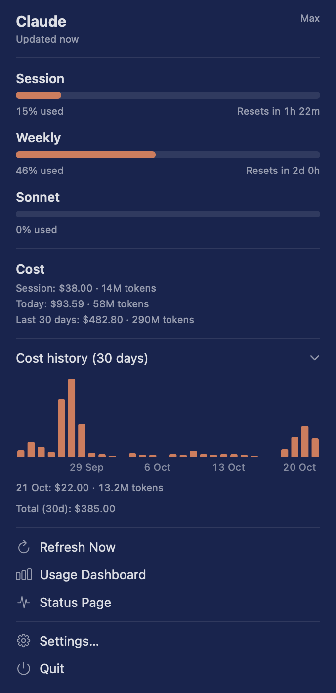

# Claude Usage

A small macOS menu bar app that shows how much of your Claude plan you've used, and what your Claude Code sessions would cost at API prices.



> **Unofficial.** Not made, endorsed, or supported by Anthropic. "Claude" is a trademark of Anthropic.

## What it shows

- **Plan limits** (Pro / Max): your 5-hour session and weekly usage, with reset countdowns. These are the same numbers as `/usage` in Claude Code.
- **Cost**: the estimated cost of your Claude Code usage at API list prices, for the current session, today, and the last 30 days.
- **Cost history**: a 30-day bar chart. Hover over a day to see its cost and token count.
- **Alerts**: a notification when the session or weekly limit passes 50%, 75% or 90%. You can choose which limits and levels alert in Settings.

## Requirements

- macOS 14 Sonoma or later (Apple silicon or Intel)
- [Claude Code](https://claude.com/claude-code), signed in with your Claude account. The app reuses that login, so it has no sign-in of its own. Without it, only the cost section works.

## Install

### Homebrew

```sh
brew install --cask jlao14/tap/claude-usage
```

### Manual

Download the latest `.dmg` from [Releases](https://github.com/jlao14/claude-usage/releases), open it, and drag **Claude Usage** into **Applications**.

### Shared file

If someone sent you `Claude-Usage-<version>.dmg` directly, open it and drag **Claude Usage** into **Applications**. The DMG includes a **How to Open** note with the steps below.

### First launch

The app is open source but not notarized by Apple, so macOS blocks it the first time:

1. Open **Claude Usage**. macOS says it can't verify the developer. Click **Done**.
2. Open **System Settings → Privacy & Security**, scroll down, and click **Open Anyway** next to the Claude Usage message.
3. Confirm, then allow the two prompts that follow:
   - **Keychain:** click **Always Allow**, so the app can read the login Claude Code saved.
   - **Notifications:** allow them if you want usage alerts.

You can check each release download against the `.sha256` file published with it.

## Privacy

- **Plan limits:** the app reads Claude Code's saved login from your Keychain (`Claude Code-credentials`). It sends that token only to `api.anthropic.com`, to fetch your usage.
- **Costs:** the app reads Claude Code's local session logs in `~/.claude/projects`. Nothing from these logs leaves your Mac.
- **Nothing else:** no analytics, no tracking, and no other network requests.

The plan-limits request uses an undocumented endpoint, so a change on Anthropic's side may break it. If that happens, the card shows a warning and the cost numbers keep working.

## Build from source

```sh
swift test                      # run the tests
swift run                       # run unbundled (notifications need the packaged app)
scripts/package.sh              # build dist/Claude Usage.app
VERSION=1.0.0 scripts/release.sh   # build the .app, .zip, .dmg and checksums
```

Needs Xcode 16 or later (Swift 6).

## Sharing the app directly

To send the app without GitHub (Drive, Slack, email, a website):

```sh
VERSION=1.0.0 scripts/share.sh
```

This builds `dist/Claude-Usage-1.0.0.dmg` and writes `dist/Claude-Usage-1.0.0-share-message.txt`. That message is ready to paste and covers:
- what the app is and what it needs
- how to install it, including the steps past the macOS block
- the file's checksum, so recipients can check it wasn't altered

Directly shared copies don't update themselves. Send a new DMG when you release a new version.

## Releasing

1. Push a tag:

   ```sh
   git tag v1.0.0 && git push origin v1.0.0
   ```

   [`.github/workflows/release.yml`](.github/workflows/release.yml) then runs the tests, builds the app, and publishes a GitHub release with the zip, DMG and checksums.

2. To update the Homebrew tap automatically on each release:
   1. Create a public repo named `homebrew-tap`.
   2. Create a fine-grained token with **Contents: read and write** access to that repo.
   3. Save the token as a repository secret named `TAP_TOKEN`.

   The workflow will then write `Casks/claude-usage.rb` to the tap.

## License

[MIT](LICENSE)
